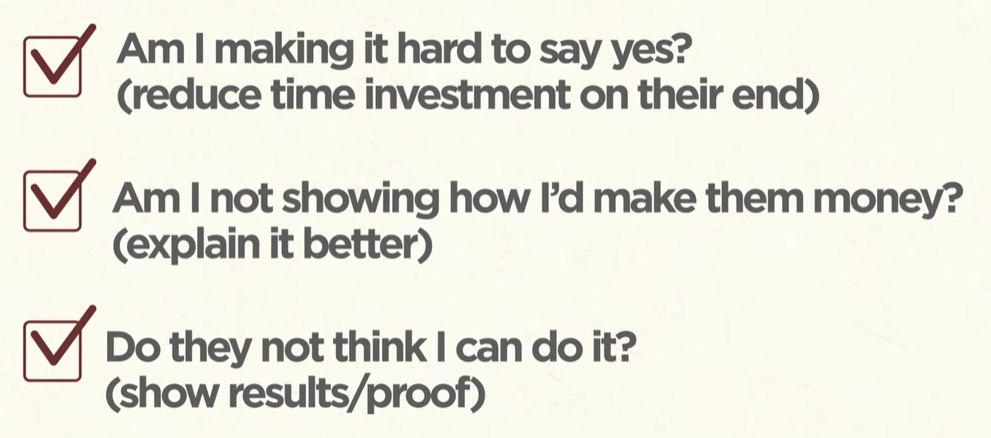

# How To Write Words That Make People Buy (Full Course)

Status: Done
Tags: Copywriting
url: https://www.youtube.com/watch?v=OP_eMk_RCWg

# workbook

[https://docs.google.com/document/d/1jrvBpd-BW61W-8E5MibgXXjPc8YqOUMJQIswkz12-UQ/edit?tab=t.0](https://docs.google.com/document/d/1jrvBpd-BW61W-8E5MibgXXjPc8YqOUMJQIswkz12-UQ/edit?tab=t.0)

# 6 Ps of Copy Thinking

1. People
    - Get crystal clear on who you Avatar (Target Audience) is.
    - Best way to research who your avatar is to talk to your customers
    - Don’t start writing until it feels like you have more than enough resources where you feel like I have too much to say, then only start.
    - If you can describe someone’s pain points better than they can, they’ll subconsciously believe that you have the solution.
2. Positioning
    - Positioning is how your product is perceived in your consumer’s mind.
    - Marketing is about creating conditions for other people to eagerly spread your ideas.
3. Promise
    - What people get when they use your product or service.
    - Its not about features or deliverables, its all about who you’re helping your customer to become. Its about what they want. Its the outcome.
    - If you are not clear about what your customers want and the core outcome that you’re helping them deliver, then they won’t be clear on it either. AND IF YOU CONFUSE, YOU LOSE.
    - The **"So What?" test** is a framework used to move from describing product features or deliverables to identifying the **core outcome** and **benefits** for the customer.
        
        How it works:
        
        You start with a feature (the "what").
        You repeatedly ask "So what?" to dig deeper into why that feature matters until you reach the emotional or functional benefit that actually drives a buying decision.
        
        **Example provided in the video:**
        
        1. **Feature:** "It's a 5x5 rug made out of silk."
        2. **So what?** "It's large enough to anchor your room."
        3. **So what?** "Your room will feel pulled together instead of random."
        4. **So what?** "When people walk in, the room will feel intentional and clean."
        5. **So what?** "You'll get compliments and people will think you're awesome."
        6. **Core Outcome:** "You'll feel like someone with great taste and a home worth showing off."
4. Proof: is evidence that backs up your promise
    1. Trust is belief with evidence.
    2. Belief without evidence is Faith.
    3. **Authority by Association:** Using the credibility of an established authority figure or expert (e.g., "Elon Musk says..." or citing a well-known doctor).
    4. **Your Own Results:** Showcasing your personal achievements, such as scaling your own business or specific financial milestones you have reached.
    5. **Client Stories and Results:** Considered the **strongest type of proof**, this involves sharing case studies and testimonials from people you have helped achieve a specific outcome.
    6. **"Deaf and Mute test"** which is an exercise to identify what proof you can provide if you were unable to speak. Instead of claiming expertise, you point to tangible items like:
    - **Logos** of companies you have worked with.
    - **Specific numbers** representing your results.
    - **Years of experience** or the total number of clients served.
5. Priority: Why should People act now?
    1. There are only two reasons why people act:
        1. They want to go toward something pleasurable
        2. Or away from something painful
        3. Note: People will jog towards pleasure but they will sprint away from pain
        4. 3 simple ways to highlight priority
            1. Scarcity
            2. Urgency
            3. Cost of In-Action
            4. Deprivation is a cousin of motivation. If you are drowning, then you won’t be casually swimming up to the surface. 
6. Process: How does your Offer work?
    1. A good offer has these 4 things:
        1. Explains why other solutions fail
        2. Creates a believable path
        3. Feels Different
        4. Its easy to understand
    2. To define your process, Jay recommends asking yourself:
        - What do most people believe?
        - Why are they wrong?
        - What do you believe instead?
        
        By following this structure—*Everyone thinks X, it's wrong because Y, and the solution is Z*
        

# 5 C’s for Writing

1. Clear: People can’t buy from your or persuaded by you if they are not clear about what you’re saying.
    1. Remove Unclear things
    2. Fire Fighter Test: if you had to warn someone of danger, would your message be instant and direct? He recommends using tools like the *Hemingway App* to grade your reading level.
2. Concise: No wasted words
    1. Remove all wasted words. Treat every word as if it costs $10. Writing on platforms like *X (Twitter)* is a great exercise to force brevity.
    2. Ask yourself: **"What can I cut without removing quality or understanding?"**
3. Concrete: Make your writing visualizable.
    1. For something important write it such that readers can visualize it. They can get clarity of what you are saying. Consider reader’s imagination as our advantage if used. 
    2. Not to be used every time.
4. Conversational
    1. Match your writing to your audience's language. 
    2. Avoid robotic, corporate jargon; instead, use the same lingo your reader group uses in daily life.
    3. Understand who you are talking to.
5. Cadence
    1. Write with a rhythm that mimics music. Vary your sentence length—mix short, punchy sentences with longer ones to keep the reader engaged and prevent the text from becoming monotonous.
    2. Read out loud

**The best copywriting is like the windows in a mall**. It acts as a transparent, 'see-through' bridge to the offer rather than drawing attention to the writing itself.

# Hooks, Bodies, and CTAs

## Hooks

<aside>
💡

**Virality = (Benefit * Relevance * Credibility) / Perceived Effort**

</aside>

- **Benefit:** Why people should care and what they will gain from reading the content or copy.
- **Relevance:** How many people the piece of work applies to.
- **Credibility:** Why they should listen to you or trust your perspective.
- **Perceived Effort:** How much work it takes to both consume the content and implement the advice.

## Body (frameworks)

1. What, Why, How (Educational Content):
    1. What is the point you are trying to make?
    2. Why people should care?
    3. How do they implement it?
2. But, Therefore
    1. Don’t tell linear stories
    2. Use but and therefore in the sentences so that story progresses naturally rather than being just a information.

## CTAs

1. What do we want people to do next?
2. **Who** you’re looking for
3. **What** they need to do
4. **When** they need to do it by
5. **How** they should do it

# How to get better at Copywriting?

## “read great writing and write more”

Analyze content and figure out which part got your attention, which part made you click the idea, etc. 

Its a long process and must be done and so you will have the skill.

## Don’t chase financial freedom, chase Financial Confidence.

Financial Confidence - The ability to grow back again from zero, if everything fall apart.

# How to make money with Copywriting?

Three Things: TRAFFIC, CONVERSION, OFFER

Opportunities:

1. Social Media and Paid Ads
    1. Shorts, Reels, Video Scripts
2. Conversion
    1. Email list
    2. Webinar
    3. Landing Page
3. Offer

Recommended Niche:

1. Tech and Startups
2. Info Brands

## Value Creation

1. Save People Time
2. Make them more money
3. Reduce their risk

# Absolute Beginner??

1. Study Copywriting
    1. Courses
    2. YT Videos
    3. Podcasts
2. Practice in Public
    1. Document Learning
    2. Share your lessons
3. Work for an Agency
4. Work for Free
    1. Use a Pitch Deck

# How to get Clients?

<aside>
💡

If you have no money, then you should have no shame. 

</aside>

Do the work upfront

# Conclusion

Start messy, imperfect but start.

YOU CANNOT LOSE IF YOU DO NOT QUIT.